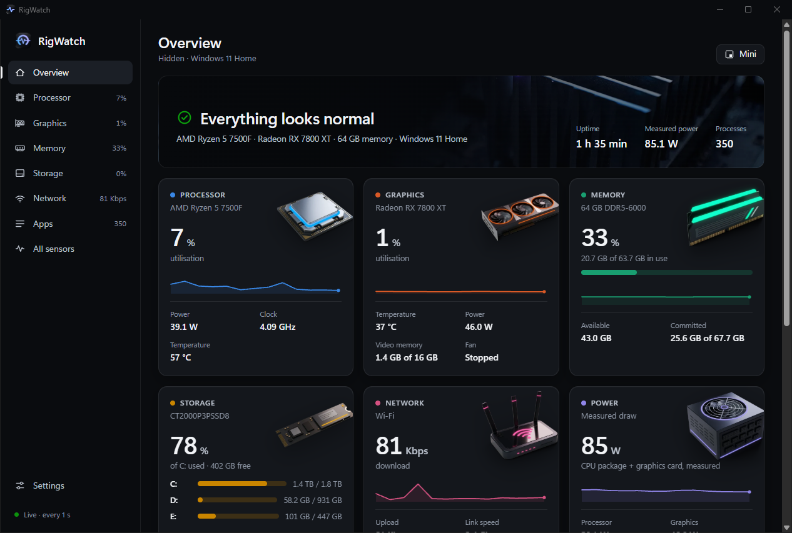
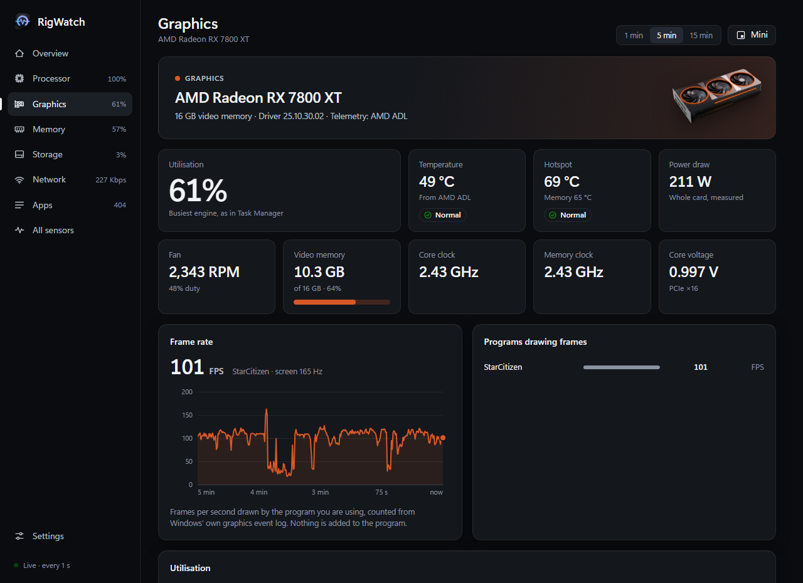
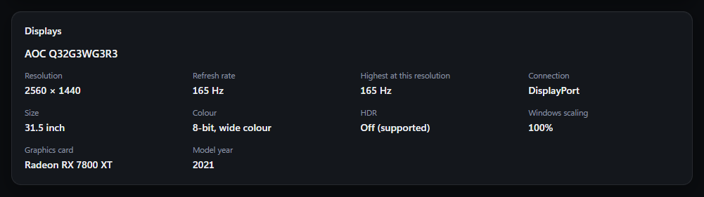

# RigWatch

A hardware monitor for Windows that shows what your PC is actually doing: processor, graphics,
memory, storage, network and power, with live charts, a full sensor table, a compact
always-on-top view and live numbers on the taskbar.

Everything on screen is **measured**. When a sensor cannot be read, RigWatch says "not available"
and explains why. It never fills the gap with an estimate.



*The computer name and network addresses are hidden in these screenshots
(Settings → Hide identifying details).*

> **Version 2 is a complete rewrite.** The original single-file tkinter version is kept as
> [`v1.0`](https://github.com/danielemilushev-hub/RigWatch/tree/v1.0).

## Download and run

RigWatch is one file, `RigWatch.exe`. There is no installer and no Python to install.

1. Download **`RigWatch.exe`** from the [latest release](https://github.com/danielemilushev-hub/RigWatch/releases/latest).
2. Put it in a folder of its own where it will stay, for example **`C:\Program Files\RigWatch`**.
   Windows asks for administrator permission to create the folder and to copy the exe into it; click
   Continue.
   [Why the folder matters](#why-the-folder-matters).
3. Double-click it. The exe is not code-signed, so the first time Windows SmartScreen may show
   "Windows protected your PC": click **More info → Run anyway**. Some antivirus tools are also wary of
   unsigned single-file apps.
4. Optional: right-click the exe → **Send to → Desktop (create shortcut)**, or turn on
   **Settings → Start with Windows**.
5. Optional, for CPU temperature, fans and voltages: install the free [PawnIO](https://pawnio.eu) driver,
   then turn on **Settings → Sensors** ([details](#cpu-temperature-case-fans-and-voltages)).

It runs on 64-bit Windows 10 and 11 and needs the Microsoft Edge WebView2 runtime, which is part of
Windows 11 and present on almost every up-to-date Windows 10 PC.

Using it on another PC is the same steps. Settings are kept per PC, so a new PC starts with the
defaults.

### Why the folder matters

- The [sensor helper](#cpu-temperature-case-fans-and-voltages) runs with administrator rights from the
  folder RigWatch is in. In `C:\Program Files` only administrators can change files, so nothing else can
  use the helper to gain those rights. Downloads, the Desktop and USB sticks do not give that protection.
- **Start with Windows** points at the exe where it is. A copy on a USB stick only starts if the stick is
  plugged in when you sign in.
- If you never turn on the sensor helper, any folder works.

### Update, move or remove

- **Update:** close RigWatch (close its window, or right-click the taskbar strip → Quit RigWatch), then
  replace `RigWatch.exe` with the new one in the same folder. If the sensor helper is on, wait half a
  minute first: it closes about 25 seconds after RigWatch, and until then Windows reports the file as in
  use. Settings, Start with Windows and the sensor helper carry on as before.
- **Move:** Start with Windows follows the exe the next time you open it from its new place. The sensor
  helper does not: turn it off and on again under Settings → Sensors.
- **Remove:** first turn off **Settings → Sensors** and **Settings → Start with Windows** (this removes the
  scheduled task and the start-up entry), close RigWatch, then delete the exe and the
  `%APPDATA%\RigWatch` folder. PawnIO, if you installed it only for RigWatch, has its own uninstaller in
  `C:\Program Files\PawnIO`.

### What it keeps on the PC

| What | Where | When |
|---|---|---|
| Settings, window data, and `rigwatch.log` if it ever fails to start | `%APPDATA%\RigWatch` | Always |
| Start-up entry | Your account's start-up list (Task Manager → Startup apps) | Only while Start with Windows is on |
| Scheduled task "RigWatch Sensor Helper" | Task Scheduler | Only while the sensor helper is on |

Nothing else: no service, no driver of its own, no files next to the exe. While it runs, the exe
unpacks itself into a temporary folder that is removed again when it closes.

### Run from source

Double-click **`RigWatch.bat`**. The first run creates a private Python environment (about a minute,
needs Python 3.11+ and an internet connection) and fetches the sensor engine used for CPU temperature
(about 3 MB); after that it opens straight away. Optional: run `tools\create-shortcut.ps1` to put a
RigWatch shortcut on your desktop.

Build the standalone exe yourself (the result lands in `dist\`):

```powershell
powershell -ExecutionPolicy Bypass -File tools\build-exe.ps1
```

### Command line

The same flags work with the exe (`RigWatch.exe --json`) and from source:

```powershell
.\.venv\Scripts\python.exe -m rigwatch               # the app window
.\.venv\Scripts\python.exe -m rigwatch --browser     # open in your browser instead
.\.venv\Scripts\python.exe -m rigwatch --server      # only the local service (http://127.0.0.1:47115)
.\.venv\Scripts\python.exe -m rigwatch --json        # print one reading as JSON and exit
.\.venv\Scripts\python.exe -m rigwatch --minimized   # start minimised, showing only the taskbar strip
.\.venv\Scripts\python.exe -m rigwatch --port 47200  # use another local port
.\.venv\Scripts\python.exe -m rigwatch --interval 2  # seconds between readings, for this run
.\.venv\Scripts\python.exe -m rigwatch --version     # print the version
```

## What you get

| View | Shows |
|---|---|
| Overview | Health verdict, one card per component, all temperatures, busiest apps |
| Processor | Utilisation, clock, measured package power, load per thread, clock and power per core |
| Graphics | Utilisation, temperature, hotspot, measured board power, fan, video memory, clocks, voltage, frame rate (FPS), workload by engine, apps using the card, and every connected monitor |
| Memory | In use, available, committed, cache, kernel pools, largest apps, installed modules |
| Storage | Per drive: temperature, health (rated life left), activity, read/write speed, lifetime totals, volumes |
| Network | Download/upload on the default route, session and startup totals, every active adapter |
| Apps | All apps with processor, memory, graphics and video-memory use; sortable and filterable |
| All sensors | Every reading with min / max / average, CSV export, and where each number comes from |
| Mini | Compact always-on-top panel for gaming or working full-screen |

Dark and light themes, °C or °F, refresh rate from twice a second to every 5 seconds, keep the window
on top, and a switch that hides the computer name and network addresses for screenshots and streaming.



### Health verdict

The banner on the Overview says "Everything looks normal" until one of these is true:

| Component | Warning | Critical |
|---|---|---|
| Processor | 85 °C | 95 °C |
| Graphics card | 85 °C, or hotspot 98 °C; video memory 97 % full | 95 °C, or hotspot 108 °C |
| Memory | 88 % in use | 95 % in use |
| Drive | The drive's own warning temperature (70 °C if it reports none); 30 % of rated life left; any media errors | The drive's own critical temperature (80 °C if none); 10 % of rated life left; the drive reports a health warning |
| Volume | Less than 5 % free | |
| Battery | 10 % and not plugged in | |

A reading that is not available never raises a warning.

### Minimised: numbers on the taskbar

Minimise the window and a compact strip appears on the taskbar, next to the weather widget, showing
processor load, memory, each graphics card's load and temperature, the frame rate of the program you
are using, and measured watts. Click it to bring the window back, drag it anywhere (the position is
remembered), right-click for a menu. Turn it off under Settings → Taskbar strip.


Windows 11 removed the deskband API, so nothing can add a real item *inside* the taskbar any more.
This is a borderless always-on-top strip sized to the taskbar and parked on it, which is as close as
third-party code can get. It never takes keyboard focus.

### Frame rate (FPS)

RigWatch shows how many frames per second the program you are using draws: on the taskbar strip, on
the Graphics page (with a chart and a list of every program that is drawing), and in the sensor table
with minimum, maximum and average.

- **Nothing is injected into games.** Windows' graphics kernel can log one event for every frame a
  program presents. RigWatch listens to that log and counts the events per program. Direct3D 9 to 12,
  Vulkan and OpenGL all pass through the same point, so one method covers them.
- **No administrator rights were needed** on the test PC, and the sensor helper is not involved.
  Windows allows this for accounts in its "Performance Log Users" group, which a signed-in account
  normally is. If Windows refuses on some account, RigWatch says "not available"; it never shows a guess.
- **Whose frame rate:** the window you are working in, including the processes it started (a browser
  draws from a child process). A dash means that program is not drawing right now. While RigWatch's
  own window, the desktop or the taskbar is in front, the program you used before it stays the one
  being measured.
- The number is the count of frames presented in the last second, so it trails by about a second.
- In **exclusive full screen** nothing can be drawn over a game without injecting into it, so the
  strip is not visible there. In borderless and windowed modes the strip is an always-on-top window
  and stays visible over the game (seen with Star Citizen in borderless mode).
- Turn it off under Settings → Frame rate (FPS). That stops the listening completely.

Checked two ways. A test page that draws on every screen refresh reported 165.0 frames per second on
a 165 Hz monitor and RigWatch counted 164 to 165. In Star Citizen (borderless, 90 to 145 FPS) the
numbers matched a second FPS counter. Other games and exclusive full screen have not been tried.

### Monitors

The Graphics page lists every connected monitor: name, resolution, refresh rate now and the highest
available at that resolution, connection (DisplayPort, HDMI, built-in …), size, colour depth, whether
HDR is on, Windows' scaling, and the graphics card it is plugged into. HDR is reported separately
from Windows' automatic wide-colour mode, which is easy to mistake for it.



### Start with Windows

Turn on **Settings → Start with Windows** and RigWatch opens by itself when you sign in. It starts
minimised, so only the taskbar strip shows; click the strip to open the window.

- It adds one entry to your own account's start-up list, the same list Task Manager shows under
  *Startup apps*. No administrator rights, no service. Turning the switch off removes the entry.
- The switch shows what Windows will really do. If you switch RigWatch off in Task Manager's list, the
  switch here says so; turning it on here allows it again.
- The entry points at the copy of RigWatch you turned it on from. If you move `RigWatch.exe`, the entry
  is corrected the next time you open the app from its new place.
- A copy on an external drive only starts if the drive is plugged in when you sign in. Windows skips a
  missing program without a message, and RigWatch tells you when this applies.
- Opening RigWatch while it is already running brings the running window forward. A second copy is
  never started.

## Where the numbers come from

No administrator rights and no kernel driver are needed for anything in this table. CPU temperature,
case fans and voltages are the exception, covered below.

| Reading | Source |
|---|---|
| CPU utilisation and clock per thread | Windows performance counters (`Processor Information`), the same figures Task Manager uses |
| CPU package and per-core power | The processor's own energy counters (RAPL) via the Windows `Energy Meter` counters |
| GPU utilisation, video memory, per-app GPU use | Windows performance counters (`GPU Engine`, `GPU Adapter Memory`, `GPU Process Memory`) |
| GPU identity and real video-memory size | DXGI |
| Radeon temperature, hotspot, fan, clocks, voltage, board power | AMD ADL, loaded from the active driver's own folder |
| GeForce temperature, fan, clocks, power | NVIDIA NVML |
| GPU temperature on any other card | Windows display kernel (`D3DKMT`), the reading Task Manager shows |
| Drive temperature, wear, power-on hours, data written | Queried from each drive (`IOCTL_STORAGE_QUERY_PROPERTY`, NVMe health log) |
| Drive activity and speed | Windows disk statistics (`IOCTL_DISK_PERFORMANCE`) |
| Memory, network, processes | Windows, via `psutil` and `GetPerformanceInfo` |
| Motherboard, BIOS, memory modules | SMBIOS firmware table |
| Frame rate (FPS) per program | Windows' graphics event log: `Microsoft-Windows-DxgKrnl` present events through a private real-time trace session |
| Monitor resolution, refresh rate, connection, colour mode | Windows display configuration (`QueryDisplayConfig`) and each monitor's EDID |

### CPU temperature, case fans and voltages

Windows keeps these behind administrator rights. The processor's thermal sensor and the motherboard's
sensor chip can only be reached through a kernel driver, which is why Task Manager shows neither, and
why every monitor that does show them (LibreHardwareMonitor, HWMonitor, HWiNFO) runs elevated.

RigWatch reads them with a small **sensor helper**. Turn it on under **Settings → Sensors**, or from the
"not available" link next to the processor temperature.

- Turning it on shows one Windows permission prompt. That registers an on-demand scheduled task,
  "RigWatch Sensor Helper". Nothing is added to Windows start-up.
- After that RigWatch starts the helper when it opens, without a prompt, and the helper exits about
  25 seconds after RigWatch closes. RigWatch itself never runs elevated.
- The helper only reads. It uses LibreHardwareMonitor's sensor engine (`rigwatch/vendor/lhm`, MPL-2.0)
  through the [PawnIO](https://pawnio.eu) driver, the same pair LibreHardwareMonitor and FanControl use.
- PawnIO is a separate, free install. RigWatch does not install a driver for you; it tells you when
  PawnIO is missing and picks it up as soon as it is there.
- A read that fails is dropped. It is never shown as 0.
- Turning the helper off removes the scheduled task again.

Two things to know before turning it on:

- The helper runs with administrator rights from the folder RigWatch is in. Anything able to change the
  files in that folder could use it to gain those rights, so keep RigWatch somewhere only you (or only
  administrators) can write to.
- If an online game's anti-cheat objects to the PawnIO driver, turn the helper off or uninstall PawnIO.

A running [LibreHardwareMonitor](https://github.com/LibreHardwareMonitor/LibreHardwareMonitor) with
**Options → Remote Web Server → Run** is still picked up automatically (`127.0.0.1:8085`) while the
helper is off.

### Not included

- Frame times and "1% low" figures: only the frames-per-second count is shown for now.
- An in-game overlay: that needs code injected into the game, which RigWatch does not do.
- Whole-system power at the wall: only the CPU package and the graphics card report measured draw.

## For developers

The service listens on this computer only (`127.0.0.1:47115`; a free port is used if that one is taken).

| Endpoint | Returns |
|---|---|
| `GET /api/snapshot` | Latest reading of every sensor |
| `GET /api/static` | Hardware inventory and the status of each data source |
| `GET /api/history` | Up to 15 minutes of history for the charted series |
| `GET /api/sensors` | Flat sensor list with min / max / average |
| `GET /api/stream` | Server-sent events, one snapshot per sample |
| `GET /api/sensors.csv`, `/api/history.csv` | CSV exports |
| `GET /api/helper` | State of the sensor helper (off, starting, on, driver missing, …) |
| `GET /api/startup` | Whether RigWatch starts with Windows (`on`, `off`, or `blocked` in Task Manager) |
| `GET /api/settings` | Current settings |
| `GET /api/ping` | `{"app": "rigwatch", "version": …}`, to check that RigWatch is running |

Layout:

```
rigwatch/
  sensors/        one module per data source (pdh, dxgi, d3dkmt, adl, nvidia, storage, smbios, winsys, bridge,
                  frames for the frame rate, displays for the monitors)
                  helper.py is the elevated sensor helper (self-contained); helper_client.py is the app's side of it
  vendor/lhm/     LibreHardwareMonitor's sensor engine and its licences. Not kept in git: fetched from
                  nuget.org by tools/fetch-sensor-engine.py (pinned SHA-512), bundled into the exe by the build
  collector.py    background sampler: snapshot, history, min/max, health alerts
  server.py       local HTTP API and static files
  app.py          window, mini mode, command line
  strip.py        the taskbar strip shown while minimised
  startup.py      the "Start with Windows" entry in the user's start-up list
  ui/             the interface (plain HTML, CSS and ES modules; no build step)
tools/            build-exe.ps1 + rigwatch.spec (standalone exe), create-shortcut.ps1
art/              Blender scripts that build and export the 3D illustrations
tests/            python -m unittest discover -s tests
```

Run the tests with `.\.venv\Scripts\python.exe -m unittest discover -s tests -v`.

Notes for anyone extending the sensor layer:

- Frame rate: the trace session is named `RigWatch-Frames-<process id>` and is stopped when RigWatch
  closes. If RigWatch is killed, the next start stops the session it left behind. Windows delivers
  the events in late, uneven batches unless asked, so `sensors/frames.py` flushes the session on every
  sample and uses one shared buffer instead of one per processor core.

- The sensor helper was run on an AMD Ryzen 5 7500F with an MSI B650 board (Nuvoton NCT6687D): CPU
  temperature, board temperatures, fans and voltages all read correctly. Intel processors and other
  board chips go through the same engine but have not been run here.
- The NVIDIA and Intel paths follow the vendors' documented APIs but were built on an all-AMD machine
  and have not been run on that hardware yet.
- On some Windows installs the classic performance counters (`\Memory`, `\PhysicalDisk`, …) fail when
  opened from Python (`psutil.swap_memory()` raises too). RigWatch only uses the newer counter sets and
  direct Win32 calls, so it is unaffected; avoid adding dependencies on the classic ones.
- AMD's `atiadlxx.dll` in `System32` can belong to a different driver package than the one running
  the card. `sensors/adl.py` loads the copy from the active driver's folder first for that reason.

## Artwork

- 3D hardware illustrations and the app icon are modelled and rendered in Blender:
  `art/blender/build_assets.py` → `art/export_assets.py` → `art/finalize_assets.py`.
- Backdrop photography (`rigwatch/ui/assets/bg`) was generated with cyberninjas.

## Tested on

Windows 11, Python 3.14, Ryzen 5 7500F, Radeon RX 7800 XT, MSI B650 board.

**Only AMD hardware has actually been exercised.** The NVIDIA and Intel paths use the vendors'
documented interfaces and degrade to "not available" rather than failing, but they are untested on
real hardware. If you run this on an NVIDIA or Intel card, an issue saying what worked and what
didn't would be genuinely useful; the output of `RigWatch.exe --json` is the most helpful thing to attach.

## Licence

MIT — see [LICENSE](LICENSE).
